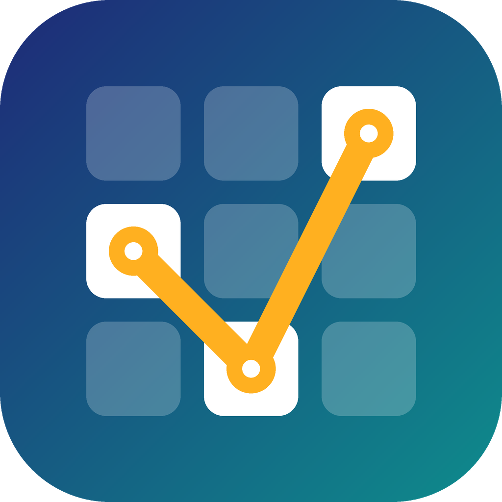
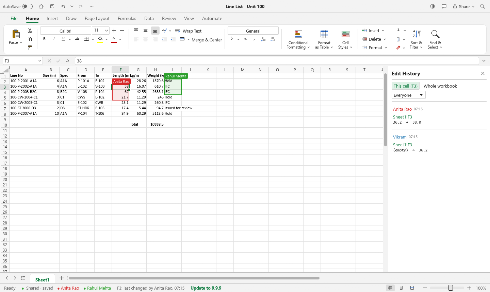

<p align="center">
  
</p>

<h1 align="center">Dexterity Sheets</h1>

<p align="center">
  <b>The spreadsheet of Dexterity Design Services Pvt. Ltd.</b><br>
  Excel-compatible workbooks, edited live by the whole team over the office network,<br>
  with every change signed by the person who made it.
</p>

<p align="center">
  <a href="../../releases/latest"></a>
  <a href="../../actions/workflows/dexterity-ci.yml"></a>
  <a href="../../actions/workflows/upstream-sync.yml"></a>
  
  
  
</p>

<p align="center">
  <a href="#a-look-around">A look around</a> ·
  <a href="#why-dexterity-sheets">Why</a> ·
  <a href="#install">Install</a> ·
  <a href="#working-together">Working together</a> ·
  <a href="#updates">Updates</a> ·
  <a href="#excel-compatibility">Excel compatibility</a> ·
  <a href="#architecture">Architecture</a> ·
  <a href="#staying-in-step-with-gridcraft">Upstream</a> ·
  <a href="#building">Building</a> ·
  <a href="#license-and-credits">License</a>
</p>

<br>

<p align="center">
  
  <br><sub><b>One line list, three engineers, live.</b> Everyone sees the others' selections with their names; the status bar says who last changed the active cell; <i>Edit History</i> shows every change, old → new, with the person and the time.</sub>
</p>

## A look around

<table>
<tr>
<td width="50%" valign="top"><p align="center"><sub><b>File › Shared.</b> Every shared workbook on the office server, who changed it last, and who has it open right now.</sub></p></td>
<td width="50%" valign="top"><p align="center"><sub><b>Versions.</b> Kept hourly, on Save, on request and before any restore. Open any of them as a copy, or restore it for everyone.</sub></p></td>
</tr>
<tr>
<td width="50%" valign="top"><p align="center"><sub><b>Updates itself.</b> A new release shows up in every running copy; one click downloads it from the office server, checks it and installs it. No admin rights.</sub></p></td>
<td width="50%" valign="top"><p align="center"><sub><b>Named accounts only.</b> The office server is found on the network automatically. No guests, no anonymous edits.</sub></p></td>
</tr>
<tr>
<td width="50%" valign="top"><p align="center"><sub><b>A real spreadsheet.</b> Tables, conditional formatting, sparklines and live charts, saved as .xlsx that Excel opens without complaint.</sub></p></td>
<td width="50%" valign="top"><p align="center"><sub><b>Formulas.</b> 500+ functions, dynamic arrays, LET and LAMBDA, structured table references.</sub></p></td>
</tr>
<tr>
<td width="50%" valign="top"><p align="center"><sub><b>Dark mode</b> and the Insert tab: tables, charts, sparklines, pictures, shapes, links and comments.</sub></p></td>
<td width="50%" valign="top"><p align="center"><sub><b>Formatting.</b> Number formats (with Indian 12,34,567 grouping and dd-mm dates, like Excel on your PC), cell styles, colour scales.</sub></p></td>
</tr>
</table>

## Why Dexterity Sheets

- **Everyone edits the same workbook at once.** No more "who has the line list open?", no
  emailed copies, no `_final_v3_RK.xlsx`. Changes appear in everyone's window in a fraction of
  a second on the office LAN.
- **Every change is signed.** Shared workbooks need a named account, so the history can always
  answer *who changed this cell, when, and from what*. Values that merely recalculated are
  never blamed on anyone.
- **Nothing to save, nothing to lose.** Each edit reaches the server's disk before anyone else
  sees it. Pull the network cable and keep typing: the edits wait and go through when the
  connection returns. Undo takes back *your* edits, never a colleague's.
- **Excel in, Excel out.** Clients send `.xlsx`, you send `.xlsx` back. Files are checked
  against Microsoft Excel itself (see [Excel compatibility](#excel-compatibility)).
- **Yours.** Built from open source, runs on your network, no subscription, no telemetry, no
  cloud. The office server is one small program on one PC.
- **Always current.** Fixes and features from the open-source GridCraft project flow in
  automatically, are tested, and reach every desk through the built-in updater.

## Install

Download from the [latest release](../../releases/latest):

| File | Where |
|---|---|
| `dexterity-sheets-<version>-windows-x64.msi` | every PC: per-user install, no administrator rights, no extra runtimes |
| `DexSheetsServer-<version>-x64.zip` | the one always-on office PC that holds shared workbooks |
| `dexterity-sheets-<version>-windows-x64-portable.zip` | running without installing |
| `SHA256SUMS` | checksums of the above |

**The office server (once, by IT):**

```powershell
# On the server PC, in an elevated PowerShell, in the unzipped folder:
powershell -ExecutionPolicy Bypass -File .\Install-Server.ps1
# creates the first administrator, opens TCP 47810 / UDP 47811 for the LAN only,
# and starts the server at every boot

# add teammates
& "C:\Program Files\Dexterity Sheets Server\DexSheetsServer.exe" --data "C:\ProgramData\Dexterity Sheets\Server" user add anita --display "Anita Rao" --role editor
```

Roles: `admin` (everything), `editor` (edit, create and share; delete own workbooks), `viewer`
(read only). Full guide: [docs/collaboration.md](docs/collaboration.md).

**Everyone else:** install the `.msi`, open Dexterity Sheets, **File › Shared**, pick the
server, sign in.

## Working together

| | |
|---|---|
| **Share** | *File › Shared › New shared workbook*, or *Share the current workbook* to upload an open `.xlsx`. The title-bar **Share** menu does the same. |
| **See each other** | Other people's selections are outlined in their colour with their name; "(typing)" while they edit a cell. Click a name in the status bar to jump to them. |
| **Who changed it** | The status bar shows who last changed the active cell. Click it, or *Review › Edit History*, for that cell's history or the whole workbook's, filterable by person. |
| **Versions** | *Review › Versions*: keep a labelled version ("Issued for review Rev B"), open any version as a separate copy, or restore one for everyone (the current state is kept first). Ctrl+S keeps a version too. |
| **Offline** | Edits made while the server can't be reached are kept and sent on reconnect; the status bar shows how many are waiting. |
| **Conflicts** | Two people changing the same cell at the same moment: the server's order decides, everyone ends up identical. Different cells never conflict. |

What the server keeps on disk, and why nothing acknowledged can be lost, is in
[docs/collaboration.md](docs/collaboration.md#how-it-works-for-maintainers).

## Updates

1. A new version is released here (by a person, or automatically after an upstream sync).
2. The office server picks it up: put `update-source.json` in its data folder
   (`{"repo": "vikramdex-ops/dexterity-sheets"}`), or drop an `.msi` into its `updates` folder.
3. Every running Dexterity Sheets shows **Update to X.Y.Z**; *Update now* downloads the installer
   over the LAN, verifies its SHA-256, installs it in place and reopens. PCs never need
   internet access.

## Excel compatibility

A test harness drives **Microsoft Excel itself** (through COM, as a black box) and compares:
formula results, number-format display, typed entry, CSV import/export, and files written by
each application opened in the other.

| Check | Result |
|---|---|
| Files written by Dexterity Sheets opened in Excel | 15/15 open, **0 repair prompts** |
| Excel recalculating our files | 0 differences |
| Function results vs Excel (295 formulas + dynamic arrays) | 343/344 |
| Number-format display text | 409/422 |
| Typed entry vs Excel with Indian regional settings | 42/42 |

Dates (dd-mm), digit grouping (12,34,567) and currency follow the Windows regional settings, as
Excel does on the same PC; files stay locale-independent.

## Architecture

An engine-first Rust workspace (from GridCraft) with Dexterity's layer on top:

| Crate | Job |
|---|---|
| `core`, `numfmt`, `formula`, `functions`, `model`, `calc`, `xlsx`, `chart`, `engine` | the spreadsheet: values, number formats (now with regional settings), parser, 500+ functions, copy-on-write workbook model, dependency-graph recalculation, XLSX/CSV, charts, the command registry |
| `ui-egui`, `apps/gridcraft` | the Windows desktop app (`DexteritySheets.exe`) |
| **`collab`** | LAN co-authoring: workbook diff/patch, the wire protocol, client, server, discovery, accounts, audit trail, versions, update distribution |
| **`apps/gridcraft-server`** | `DexSheetsServer.exe`: accounts CLI, the server, GitHub release fetcher |
| **`ui-egui/src/collab_ui.rs`** | everything sharing looks like in the window |

**How live editing works.** Each window compares its workbook with the last state it
synchronised and sends the difference as a *patch* of absolute assignments (cells with their
style, sheet settings key by key, the sheet list). Because patches come from comparing
workbooks, every way of changing one (commands, paste, fill, sort, undo, scripts) is shared
without per-feature code. The server numbers each patch, writes it to an append-only log
(fsync), records the audit lines, and broadcasts it. Every window shows *server state + its own
not-yet-acknowledged patches*, so all copies converge on the server's order. Remote patches are
also applied to each window's undo history, which is why Undo only takes back your own edits.

## Staying in step with GridCraft

Dexterity Sheets tracks [storytold/gridcraft](https://github.com/storytold/gridcraft). The
**Upstream sync** workflow runs every 6 hours:

1. The `upstream` branch is updated to official GridCraft.
2. `packaging/dexterity/sync_upstream.py` merges it into `main`, keeping Dexterity's own files,
   re-applying branding where only text conflicts, and checking with `check_overlay.py` that every
   hook into GridCraft's code is still there.
3. A clean merge runs the full CI (format, clippy, engine and file-format tests, collaboration
   tests, build, three-window end-to-end test), then is tagged and released, and the updater
   delivers it.
4. Anything needing judgement becomes a pull request instead; nothing untested is released.

Dexterity's code lives in its own files; GridCraft's files carry only small, checked hooks.
Details and the rules that keep merges easy: [packaging/dexterity/UPSTREAM.md](packaging/dexterity/UPSTREAM.md).
Versions: `packaging/dexterity/VERSION` is Dexterity Sheets'; `Cargo.toml` keeps GridCraft's.

## Building

Rust 1.95+ with the MSVC toolchain; WiX 5 for the installer.

```powershell
cargo build --release -p gridcraft -p gridcraft-server -p gridcraft-cli
#   target\release\DexteritySheets.exe   the app
#   target\release\DexSheetsServer.exe   the office server
#   target\release\gridcraft-cli.exe     headless CLI (eval, convert, run commands)
pwsh packaging/windows/package.ps1 -Arch x64     # MSI + portable zip, static C runtime
```

Tests:

```powershell
cargo test --release -p gridcraft-collab                         # patches, convergence, real TCP server
py -3 packaging/dexterity/tests/lan_e2e.py target/release        # 3 windows + server, 19 checks
py -3 packaging/dexterity/tests/update_e2e.py old.msi new.msi target/release/DexSheetsServer.exe work
py -3 packaging/dexterity/tests/screenshots.py target/release    # regenerates docs/images
```

## License and credits

Dexterity Sheets is built from [GridCraft](https://github.com/storytold/gridcraft) by the
ArtCraft team and contributors, dual-licensed under [MIT](LICENSE-MIT) or
[Apache-2.0](LICENSE-APACHE); notices in [NOTICE](NOTICE), assets in
[ATTRIBUTION.md](ATTRIBUTION.md). Thank you to everyone who built GridCraft.

Dexterity Sheets is not affiliated with or endorsed by the ArtCraft team and ships none of its
trademarks. Microsoft Excel is a trademark of Microsoft Corporation; Excel was used only as a
black-box reference, and no Microsoft code, artwork or files are included.
