<a href="https://github.com/vikramdex-ops/dexterity-sheets/releases/latest/download/DexteritySheets-Setup.exe">
  
</a>

<p align="center">
  <a href="https://github.com/vikramdex-ops/dexterity-sheets/releases/latest/download/DexteritySheets-Setup.exe"></a>
  &nbsp;
  <a href="https://vikramdex-ops.github.io/dexterity-sheets/"></a>
</p>

<p align="center">
  <sub><!-- dex:release -->Version <b>1.3.1</b> · 29 October 2026 · based on GridCraft 0.13.0<!-- /dex:release --> · Windows 10 and 11 · no administrator rights needed · updates itself</sub>
</p>

<p align="center">
  <a href="../../releases/latest"></a>
  <a href="../../actions/workflows/dexterity-ci.yml"></a>
  <a href="../../actions/workflows/upstream-sync.yml"></a>
  
</p>

<br>

<h2 align="center">Your team's spreadsheet. Live, together, on the office network.</h2>

<p align="center">
  Dexterity Sheets is the spreadsheet of <b>Dexterity Design Services Pvt. Ltd.</b><br>
  It opens and saves Excel files, and the whole team can work in the same workbook at the same time.<br>
  Everybody signs in, so every change shows <i>who</i> made it, <i>when</i>, and what it was before.
</p>

<p align="center">
  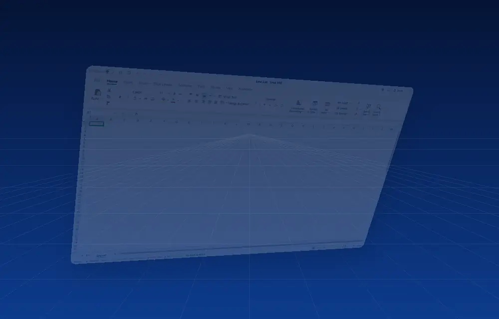
  <br><sub>Recorded from the real app, not a mock-up: three engineers filling in one line list together.</sub>
</p>

<br>

## Start in three steps

<p align="center">
  
</p>

1. **Install.** [Download `DexteritySheets-Setup.exe`](https://github.com/vikramdex-ops/dexterity-sheets/releases/latest/download/DexteritySheets-Setup.exe) and double-click it. No
   administrator rights, nothing else to install. If Windows says *"Windows protected your PC"*,
   click **More info → Run anyway** (the installer isn't code-signed yet).
2. **Sign in.** Open Dexterity Sheets and go to **File › Shared**. The office server is found on
   its own; enter the user name and password IT gave you.
3. **Share and edit together.** Open any workbook from wherever you keep it (your `D:` drive, a
   project folder, the network drive) and click **Share › Share…**. The file stays
   where it is and keeps everyone's edits; your team sees each other's changes almost instantly.

## What it does for you

<table>
<tr>
<td width="33%" valign="top"><p><b>Share any file, from where it is.</b> Open it, click Share, and the team edits it with you live. Your file keeps everyone's edits. No emailed copies, no <code>_final_v3_RK.xlsx</code>.</p></td>
<td width="33%" valign="top"><p><b>Every change has a name on it.</b> No guests and no anonymous edits: the status bar tells you who last changed the cell you're on.</p></td>
<td width="33%" valign="top"><p><b>See every change.</b> Edit History lists each change, old → new, with the person and the time. Filter by cell or by person.</p></td>
</tr>
<tr>
<td width="33%" valign="top"><p><b>Nothing gets lost.</b> Versions are kept every hour and on every save. Open any of them as a copy, or bring one back for everyone.</p></td>
<td width="33%" valign="top"><p><b>Excel in, Excel out.</b> Clients send <code>.xlsx</code>, you send <code>.xlsx</code> back. Formulas, formats, charts and tables survive the trip.</p></td>
<td width="33%" valign="top"><p><b>Always up to date.</b> When there's a new version, the status bar says so. One click and it installs itself and reopens. Trouble with a new version? <b>Help › Roll Back</b>, and tell IT which feature broke.</p></td>
</tr>
<tr>
<td width="33%" valign="top"><p><b>Share with the right people.</b> The whole office or named colleagues, as editors or viewers, until a date you pick. Copy a link into a chat; a Windows notification tells them it was shared.</p></td>
<td width="33%" valign="top"><p><b>Check and compare.</b> <b>Compare Files</b> lists what changed between Rev A and Rev B. <b>Quality Check</b> and <b>Formula Diagnostics</b> find duplicates, blanks, bad dates and broken formulas, each with its cell.</p></td>
<td width="33%" valign="top"><p><b>Never lose unsaved work.</b> If the app or Windows stops unexpectedly, the next start offers to recover each workbook, open its saved version, or compare the two.</p></td>
</tr>
<tr>
<td width="33%" valign="top"><p><b>Start from the office's templates.</b> <b>File › New</b> lists the approved project trackers, registers and minutes, with a preview. A new spreadsheet is your own copy: a later version of the template never changes it.</p></td>
<td width="33%" valign="top"><p><b>Let the server do the routine checks.</b> <b>Automation rules</b> on a shared spreadsheet: every Monday find overdue items and run the Quality Check, or stamp the date when a status becomes Completed. Fixed steps only, no macros.</p></td>
<td width="33%" valign="top"><p><b>Told when it matters.</b> Windows notifications when something is shared with you, your access changes, others edited while you were away (one summary), or a new version is ready. Mute a spreadsheet or get one summary an hour.</p></td>
</tr>
</table>

## A look around

<table>
<tr>
<td width="50%" valign="top">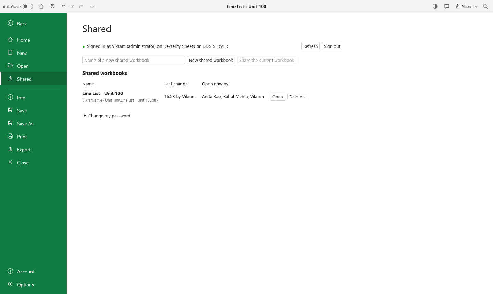<p align="center"><sub><b>File › Shared.</b> Every workbook your team is sharing, whose file it is, who changed it last, and who has it open right now.</sub></p></td>
<td width="50%" valign="top">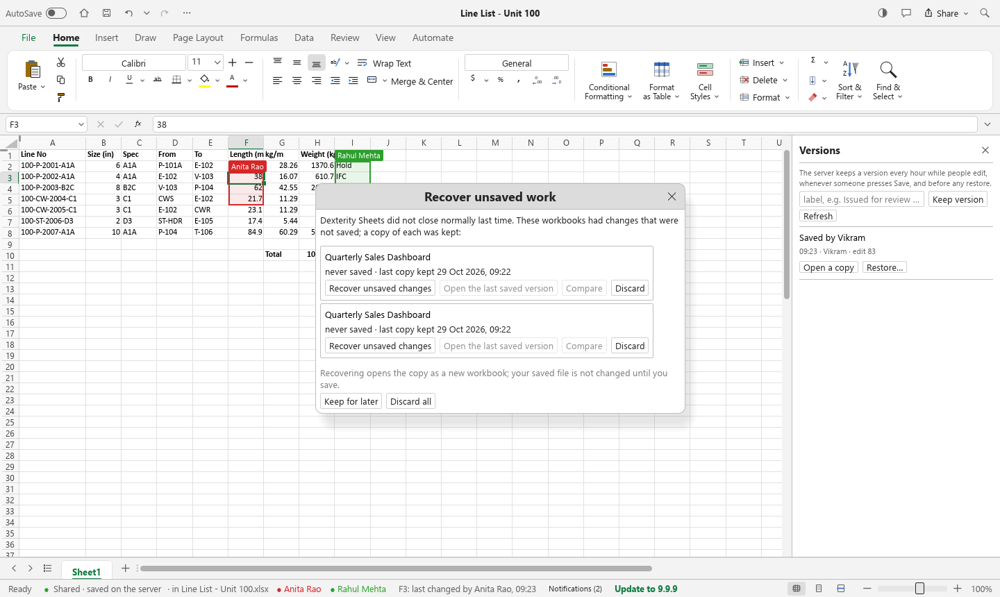<p align="center"><sub><b>Versions.</b> Kept hourly, on Save, on request and before any restore. Open any of them as a copy, or restore it for everyone.</sub></p></td>
</tr>
<tr>
<td width="50%" valign="top">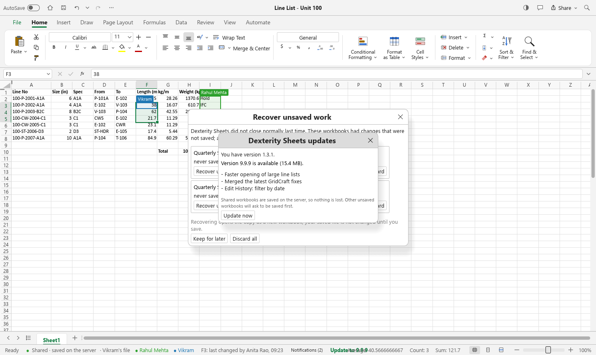<p align="center"><sub><b>Updates itself.</b> A new release shows up in every running copy; one click downloads it from the office server, checks it and installs it. No admin rights.</sub></p></td>
<td width="50%" valign="top">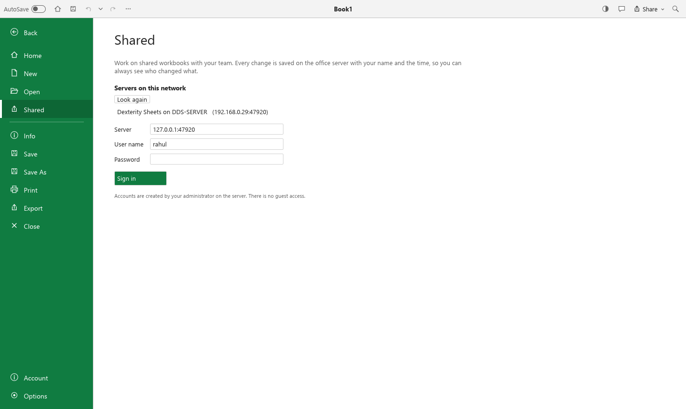<p align="center"><sub><b>Named accounts only.</b> The office server is found on the network automatically. No guests, no anonymous edits.</sub></p></td>
</tr>
<tr>
<td width="50%" valign="top">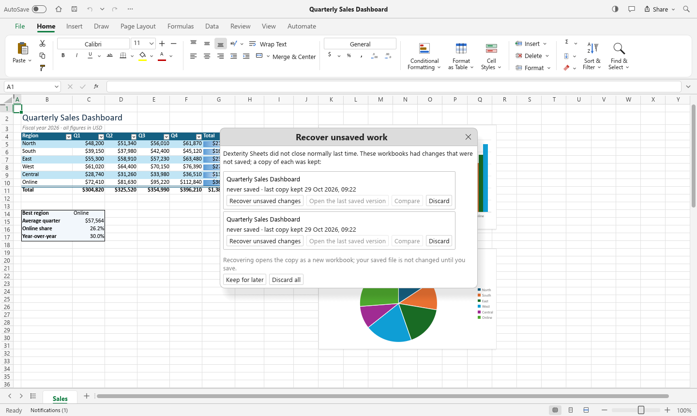<p align="center"><sub><b>A real spreadsheet.</b> Tables, conditional formatting, sparklines and live charts, saved as .xlsx that Excel opens without complaint.</sub></p></td>
<td width="50%" valign="top">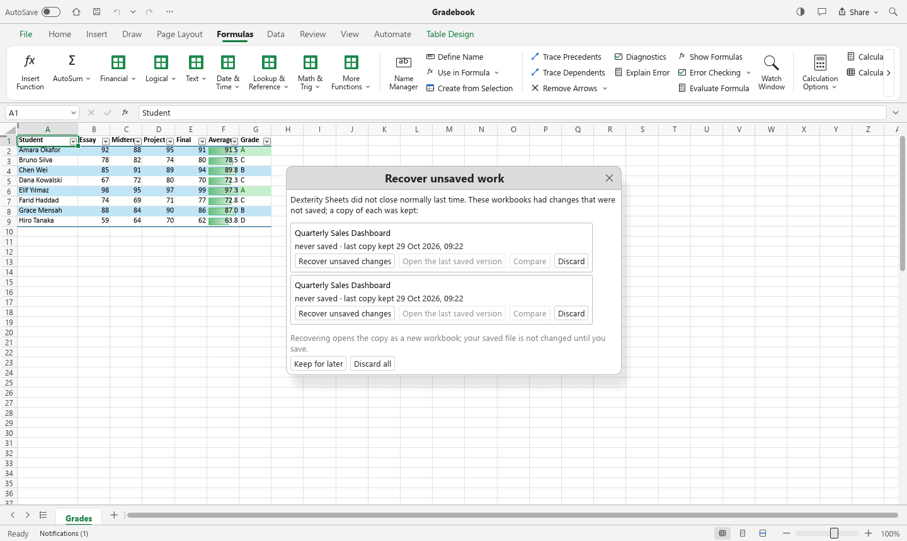<p align="center"><sub><b>Formulas.</b> 500+ functions, dynamic arrays, LET and LAMBDA, structured table references.</sub></p></td>
</tr>
<tr>
<td width="50%" valign="top">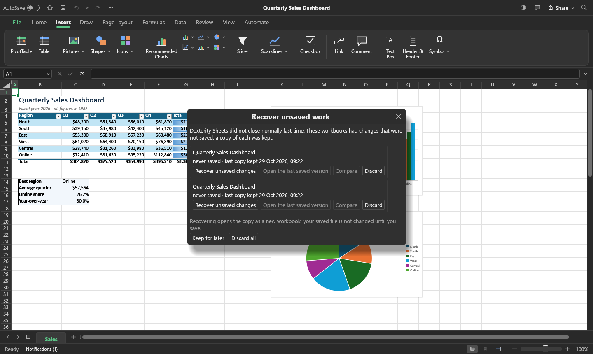<p align="center"><sub><b>Dark mode</b> and the Insert tab: tables, charts, sparklines, pictures, shapes, links and comments.</sub></p></td>
<td width="50%" valign="top">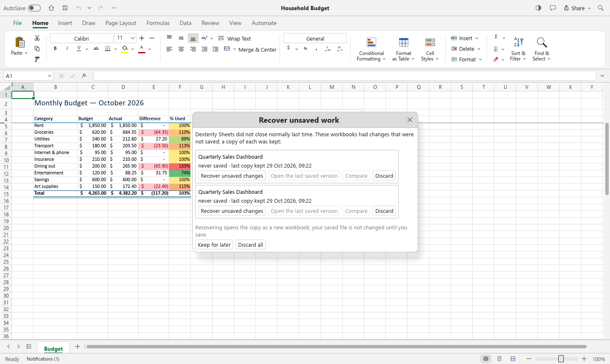<p align="center"><sub><b>Formatting.</b> Number formats (with Indian 12,34,567 grouping and dd-mm dates, like Excel on your PC), cell styles, colour scales.</sub></p></td>
</tr>
<tr>
<td width="50%" valign="top">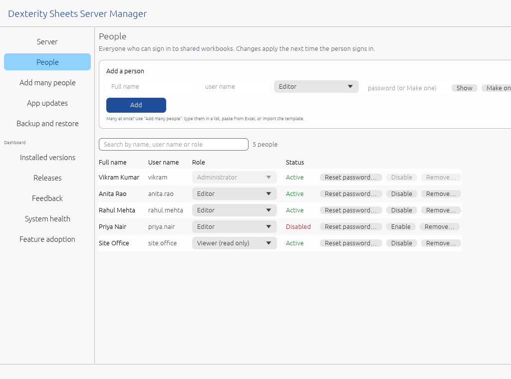<p align="center"><sub><b>Server Manager for IT.</b> Add people, change roles, reset passwords, disable or remove: no commands to type.</sub></p></td>
<td width="50%" valign="top">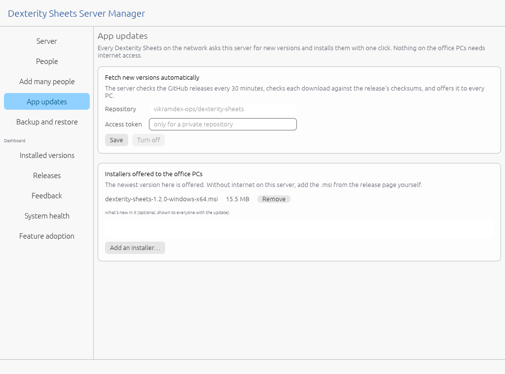<p align="center"><sub><b>Updates for every PC.</b> The server fetches each new version and offers it to every Dexterity Sheets on the network.</sub></p></td>
</tr>
</table>

## What's new

<!-- dex:whatsnew -->
- Honor CARGO_BUILD_TARGET in FreeBSD packaging for aarch64 release builds (#2847) ([146161b4](https://github.com/storytold/gridcraft/commit/146161b4b450a56e5e59a083ba0478582d1e602b))
- Grant network access so update checks can reach GitHub (#2841) ([70327cd3](https://github.com/storytold/gridcraft/commit/70327cd3d9b7de9af1bcaa33488c0736a0d346d8))
- Release 0.13.0 ([43284377](https://github.com/storytold/gridcraft/commit/43284377d2466037628e57d8ad0c891778fdb45c))
- Enforce Rust coding standards via Clippy ([GridCraft #2711](https://github.com/storytold/gridcraft/pull/2711))

[Everything in 1.3.1](https://github.com/vikramdex-ops/dexterity-sheets/releases/tag/v1.3.1).
<!-- /dex:whatsnew -->

Dexterity Sheets is built on the open-source [GridCraft](https://github.com/storytold/gridcraft)
spreadsheet. Every improvement made there is merged in automatically, tested, and delivered to
every desk by the built-in updater, usually within hours.

## Questions

<details>
<summary><b>Is it like Excel?</b></summary>

It looks and works the way you expect: the same ribbon tabs, the same shortcuts, 500+ functions
(`VLOOKUP`, `XLOOKUP`, `SUMIFS`, `IFS`, dynamic arrays…), tables, conditional formatting, charts,
filters and printing. It reads and writes real `.xlsx` files that Excel opens without complaint.
Dates and numbers follow your Windows settings (dd-mm-yyyy, 12,34,567) like Excel does.
</details>

<details>
<summary><b>Do I need the internet?</b></summary>

No. Everything runs on the office network: your files stay in your folders, and the office
server passes edits between PCs and keeps the history. Nothing goes to anyone's cloud. Only the
office server goes online, to fetch new versions.
</details>

<details>
<summary><b>What if two people change the same cell?</b></summary>

Both changes are kept in Edit History. The one the server received last is the value everyone
sees, and everyone ends up with exactly the same workbook. People editing different cells never
get in each other's way, and Undo only takes back <i>your</i> changes.
</details>

<details>
<summary><b>What if the network drops while I'm typing?</b></summary>

Keep working. Your edits are kept on your PC and go through as soon as the office server can be
reached again; the status bar shows how many are waiting. Nothing the server has confirmed can be
lost: it writes every change to disk before anyone else sees it.
</details>

<details>
<summary><b>Can I share a file that's on my own PC or in a project folder?</b></summary>

Yes, and that's the normal way to work. Open the file from wherever it is saved (`D:\Projects\…`,
your Desktop, the network drive), then click **Share › Share…**. Nothing is moved or
copied anywhere for you to look after:

- Your teammates find it in **File › Shared**, listed as your file, and edit it with you live.
- Your file is saved with everyone's edits as they happen, so it is always the team's latest.
  **Ctrl+S** saves it at once and also keeps a version.
- When the work is done, **Share › Stop sharing** hands the file back to you with every edit
  in it. Everyone else is told, and keeps a copy in their window.

A file that isn't shared is just a file: open and save `.xlsx` and `.csv` anywhere, like any
spreadsheet.
</details>

<details>
<summary><b>Someone opens a file that's already being shared. What happens?</b></summary>

They join the live workbook instead of editing a copy of their own, so a file on the network
drive never splits into two versions. If you close a shared file and open it again later, it
rejoins and catches up with what the team did meanwhile.
</details>

<details>
<summary><b>What if the file is changed outside Dexterity Sheets while it's shared?</b></summary>

It is never overwritten. If another program (Excel, a copy from email) saves over a shared file,
Dexterity Sheets stops writing to it and says so. Everyone's edits are still in the shared
workbook: use **Save As** to keep them as a file.
</details>

<details>
<summary><b>Who can see or change a shared workbook?</b></summary>

Only people with an account on the office server. IT gives each person a role: <b>viewer</b>
(read only), <b>editor</b> (edit, create, share) or <b>admin</b>. Every change is recorded with
the name of the person who made it.
</details>

<details>
<summary><b>How do I update?</b></summary>

You don't have to do anything. When a new version is out, the status bar shows
<b>Update to X.Y.Z</b>: click it and Dexterity Sheets installs the update and reopens. You can also
use <b>Automate › Check for Updates…</b>
</details>

<details>
<summary><b>Windows says "Windows protected your PC". Is it safe?</b></summary>

That message appears for any program that isn't code-signed yet. Click <b>More info → Run
anyway</b>. Every release lists SHA-256 checksums and is built and tested automatically from the
code in this repository.
</details>

## For IT

<details>
<summary><b>Files in every release</b></summary>

From the [latest release](../../releases/latest):

| File | What it is |
|---|---|
| `DexteritySheets-Setup.exe` | The installer for everyone: double-click. Per-user, no administrator rights, no extra runtimes. `/quiet` or `/passive` for silent installs, `/log <file>` for a log. |
| `dexterity-sheets-<version>-windows-x64.msi` | The same installer as an MSI, for deployment tools: `msiexec /i … /qn` |
| `dexterity-sheets-<version>-windows-x64-portable.zip` | Runs without installing |
| `DexSheetsServer-Setup.exe` | The office server, for the one always-on PC: double-click. Installs the server as a Windows service and the **Server Manager**. `/quiet` for silent installs. |
| `DexSheetsServer-<version>-x64.msi` | The same server installer as an MSI, for deployment tools |
| `SHA256SUMS` | Checksums of all of the above |

Before any release is published it has passed the full test suite, a live three-window
co-editing test, and installer tests: the app's two installers are installed, started, asked to
calculate and uninstalled; the server's two are installed, checked for a running service, the
firewall rules and a locked data folder, opened in the Server Manager, and uninstalled.
</details>

<details open>
<summary><b>Setting up the office server (once, no commands)</b></summary>

1. On the office PC that stays on, run **`DexSheetsServer-Setup.exe`** from the
   [latest release](../../releases/latest) and click **Install** (Windows asks for administrator
   rights once). It installs the server as a Windows service that starts with Windows and
   restarts itself if it ever stops, and opens the firewall for the office network only.
2. The **Dexterity Sheets Server Manager** opens. Create the first administrator account.
3. Add your team on the **People** page, one by one, or many at once on **Add many people**:
   type them into the list, paste rows copied from Excel, or click **Download template**, fill
   it in, and **Import from file**. Every row is checked before anything is created; passwords
   left empty are made for you. Then **Save the sign-in sheet** to hand the passwords out.

<p align="center">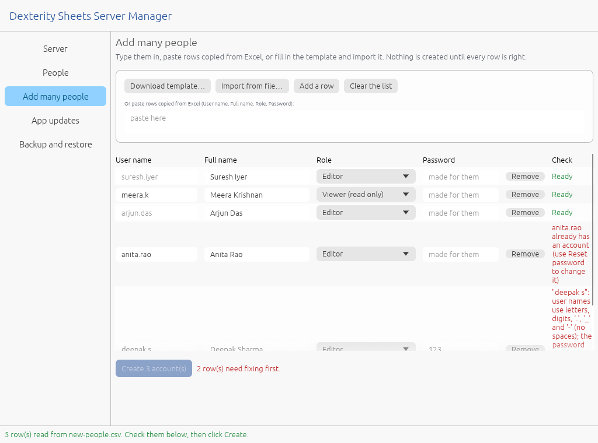</p>

Everything else is in the Server Manager too, so the job can be handed to anyone:

| Page | What it does |
|---|---|
| **Server** | Running or stopped, with Start / Stop / Restart; the name, computer name and addresses teammates use; whether the firewall is open (and a button to open it); the data folder and its size; the server log |
| **People** | Everyone who can sign in: change a role, reset a password (a readable one is made and shown once), disable or remove. The last administrator can't be locked out. |
| **Add many people** | The bulk list described above |
| **App updates** | Fetch new versions of Dexterity Sheets from this GitHub repository automatically, or add an `.msi` by hand; every PC on the network is offered it |
| **Backup and restore** | One `.zip` with every account, shared workbook, edit history and version; restoring keeps the data it replaces |
| **Installed versions** | Which Dexterity Sheets version each PC runs, its channel and when it was last seen, with a count per version |
| **Releases** | Each installer's channel (stable or testing), status (OK, known issue, deprecated, blocked) and the note people running it see; which version stable and testing PCs are offered and where a blocked version rolls back to; whether updates are offered, installed on their own or never offered |
| **Feedback** | Problem reports sent with Help › Report a Problem, grouped by version and feature, each readable in full (with its logs when included); **Open GitHub issue** fills in a new issue without names of people or PCs |
| **System health** | Failed updates, starts after a crash or forced shutdown, and errors, per version over 7 and 30 days, and the latest 50 |
| **Feature adoption** | The 30 most used commands and the rarely used ones over 7, 30 or 90 days, for all versions or one (command names only) |

<p align="center">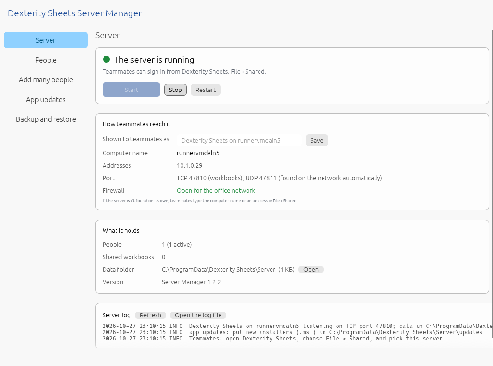</p>

Roles: **Editor** (edit, create and share), **Viewer** (read only), **Administrator** (also
manages shared workbooks). The data lives in `C:\ProgramData\Dexterity Sheets\Server`, readable
only by administrators; uninstalling never deletes it. Full guide:
[docs/collaboration.md](docs/collaboration.md).
</details>

<details>
<summary><b>Using shared workbooks: the details</b></summary>

| | |
|---|---|
| **Share** | Open the file from wherever it is saved and click **Share › Share…** (or *File › Shared › Share the current workbook*). The file stays where it is: the app of the person who shared it saves everyone's edits into it a second after each change, and on Ctrl+S. *File › Shared › New shared workbook* starts an empty one. |
| **Who can open it** | Everyone at the office, or named people, each as an **Editor** or a **Viewer**, optionally until an end date; choose whether viewers may save a copy. **Copy link** gives a link for a chat or e-mail that opens the spreadsheet in the app after checking the reader's access. |
| **Where your edits are** | The status bar says **saved on the server**, **saving N edit(s)**, **offline** or **out of step, reloading**; a workbook being shared shows **Sharing · uploading** until the server has it. |
| **Opening a shared file** | Opening a file that is being shared joins the live workbook, so a file on the network drive never splits into two versions. Reopening your own shared file rejoins it and brings the file up to date. |
| **Stop sharing** | *Share › Stop sharing (keep my file)*: the file gets every edit and is just a file again; everyone else is told and keeps a copy in their window. If another program changed the file while it was shared, it is never overwritten: the app says so and the edits stay in the shared workbook (Save As keeps them). |
| **See each other** | Other people's selections are outlined in their colour with their name; "(typing)" while they edit a cell. Click a name in the status bar to jump to them. |
| **Who changed it** | The status bar shows who last changed the active cell. Click it, or *Review › Edit History* (Excel's *Show Changes*), for that cell's history or the whole workbook's, filterable by person. |
| **Versions** | *Review › Versions*: keep a labelled version ("Issued for review Rev B"), open any version as a separate copy, or restore one for everyone (the current state is kept first). Ctrl+S keeps a version too. |
| **Offline** | Edits made while the server can't be reached are kept and sent on reconnect; the status bar shows how many are waiting. |
| **Conflicts** | Two people changing the same cell at the same moment: the later edit wins, both are told who changed it and which value was kept, and the replaced value stays in Edit History. Different cells never conflict. |
| **Automation rules** | *Share › Automation rules…*: on a schedule or when a value changes, the office server finds overdue items, runs the Quality Check, writes a report, stamps a completion time or notifies people. Fixed steps only: no macros or scripts. |

What the server keeps on disk, and why nothing acknowledged can be lost, is in
[docs/collaboration.md](docs/collaboration.md#how-it-works-for-maintainers).
</details>

## For developers

<details>
<summary><b>Excel compatibility, measured against Excel itself</b></summary>

A test harness drives **Microsoft Excel itself** (through COM, as a black box) and compares:
formula results, number-format display, typed entry, CSV import/export, and files written by
each application opened in the other.

| Check | Result |
|---|---|
| Files written by Dexterity Sheets opened in Excel | 15/15 open, **0 repair prompts** |
| Excel recalculating our files | 0 differences |
| Function results vs Excel (295 formulas + dynamic arrays) | 343/344 |
| Number-format display text | 409/422 |
| Typed entry vs Excel with Indian regional settings | 42/42 |

Dates (dd-mm), digit grouping (12,34,567) and currency follow the Windows regional settings, as
Excel does on the same PC; files stay locale-independent.

What Dexterity Sheets does and does not do yet, feature by feature against official GridCraft and
the latest Excel, is in [docs/dexterity-parity-audit.md](docs/dexterity-parity-audit.md); the
screen-by-screen check that nothing is a placeholder is
[docs/dexterity-ui-audit.md](docs/dexterity-ui-audit.md).
How shared workbooks are kept intact (the blank-shared-workbook investigation, the sync
states and the regression tests) is in
[docs/dexterity-p0-persistence.md](docs/dexterity-p0-persistence.md); what is planned next, in
[docs/dexterity-roadmap.md](docs/dexterity-roadmap.md).
</details>

<details>
<summary><b>Architecture</b></summary>

An engine-first Rust workspace (from GridCraft) with Dexterity's layer on top:

| Crate | Job |
|---|---|
| `core`, `numfmt`, `formula`, `functions`, `model`, `calc`, `xlsx`, `chart`, `engine` | the spreadsheet: values, number formats (now with regional settings), parser, 500+ functions, copy-on-write workbook model, dependency-graph recalculation, XLSX/CSV, charts, the command registry |
| `ui-egui`, `apps/gridcraft` | the Windows desktop app (`DexteritySheets.exe`) |
| **`collab`** | LAN co-authoring: workbook diff/patch, the wire protocol, client, server, discovery, accounts, audit trail, versions, update distribution |
| **`apps/gridcraft-server`** | `DexSheetsServer.exe`: the server (as a Windows service), accounts CLI, GitHub release fetcher |
| **`apps/gridcraft-server-manager`** | `DexSheetsServerManager.exe`: the server's control panel (people, bulk import from a template, service, firewall, updates, backups) |
| **`ui-egui/src/collab_ui.rs`** | everything sharing looks like in the window |

**How live editing works.** Each window compares its workbook with the last state it
synchronised and sends the difference as a *patch* of absolute assignments (cells with their
style, sheet settings key by key, the sheet list). Because patches come from comparing
workbooks, every way of changing one (commands, paste, fill, sort, undo, scripts) is shared
without per-feature code. The server numbers each patch, writes it to an append-only log
(fsync), records the audit lines, and broadcasts it. Every window shows *server state + its own
not-yet-acknowledged patches*, so all copies converge on the server's order. Remote patches are
also applied to each window's undo history, which is why Undo only takes back your own edits.
</details>

<details>
<summary><b>Staying in step with GridCraft (fully automatic)</b></summary>

Every 6 hours the **Upstream sync** workflow checks
[storytold/gridcraft](https://github.com/storytold/gridcraft) and, when there is something new:

1. **Checks it's safe:** it refuses if upstream rewrote its history or `main` is broken.
2. **Merges** into a candidate, never straight into `main`. Dexterity's files stay ours, branding
   is re-applied, and our small hooks into GridCraft's code are put back even when upstream moves
   code around (`reapply_overlay.py`, verified by `check_overlay.py`).
3. **Tests** that exact candidate: format, lint, every engine test, the collaboration tests, and
   three app windows editing one workbook live.
4. **Builds and tries the installers:** `DexteritySheets-Setup.exe` and the `.msi` are each
   installed, started, asked to calculate, and uninstalled; the server's `DexSheetsServer-Setup.exe`
   and `.msi` are installed as a running service, checked, and uninstalled.
5. **Releases** it (draft → upload → verify → publish), then refreshes this README, the
   screenshots, the demo animation and the [website](https://vikramdex-ops.github.io/dexterity-sheets/). Every PC is offered the update.
6. Anything that needs judgement becomes a pull request or an issue for a person. Nothing
   untested is ever released.

Details: [packaging/dexterity/UPSTREAM.md](packaging/dexterity/UPSTREAM.md).
Versions: `packaging/dexterity/VERSION` is Dexterity Sheets'; `Cargo.toml` keeps GridCraft's.
</details>

<details>
<summary><b>The rules, and the guards that enforce them</b></summary>

[`RULES.md`](RULES.md) is binding for every change, by people, workflows or AI agents. What
enforces it:

| Guard | When | What it stops |
|---|---|---|
| **Upstream sync** | every 6 hours | GridCraft changes reaching users untested: each is merged on a candidate, fully tested, built and installer-tested before release |
| **Excel watch** ([workflow](.github/workflows/dexterity-excel-watch.yml)) | daily | a new Microsoft Excel release going unnoticed: each one becomes an `excel-release` issue listing its Excel items, and with an `ANTHROPIC_API_KEY` secret an agent proposes the implementation as a pull request |
| **Docs check** ([`docs_check.py`](packaging/dexterity/docs_check.py)) | every push and PR | a user-visible change without a [`CHANGES.md`](packaging/dexterity/CHANGES.md) line; the README or landing page naming a file a release doesn't ship; broken images and links; "coming soon" or placeholder text in the app |
| **Performance gate** ([`perf_gate.py`](packaging/dexterity/tests/perf_gate.py), [budgets](packaging/dexterity/perf-budget.json)) | every push and release | start-up, memory, idle CPU, typing, opening and scrolling a 2-million-cell file, memory given back after closing |
| **Installer tests** | every release | an installer that doesn't install, start, work and uninstall cleanly (app and server) |

`CHANGES.md` is written once per change; the release notes, this README's "What's new" and the
landing page are generated from it.
</details>

<details>
<summary><b>Building and testing</b></summary>

Rust 1.95+ with the MSVC toolchain; WiX 5 for the installer.

```powershell
cargo build --release -p gridcraft -p gridcraft-server -p gridcraft-server-manager -p gridcraft-cli
#   target\release\DexteritySheets.exe         the app
#   target\release\DexSheetsServer.exe         the office server
#   target\release\DexSheetsServerManager.exe  its control panel
#   target\release\gridcraft-cli.exe     headless CLI (eval, convert, run commands)
pwsh packaging/windows/package.ps1 -Arch x64     # app and server Setup.exe + MSI, portable zip
```

Tests:

```powershell
cargo test --release -p gridcraft-collab                         # patches, convergence, real TCP server
py -3 packaging/dexterity/tests/lan_e2e.py target/release        # 3 windows + server, 19 checks
py -3 packaging/dexterity/tests/update_e2e.py old.msi new.msi target/release/DexSheetsServer.exe work
py -3 packaging/dexterity/tests/installer_smoke.py dist 1.2.3   # both installers: install, start, uninstall
py -3 packaging/dexterity/tests/server_installer_smoke.py dist 1.2.3   # server installers (as administrator)
py -3 packaging/dexterity/tests/server_manager_shots.py target/release media   # Server Manager screenshots
py -3 packaging/dexterity/tests/screenshots.py target/release    # regenerates docs/images + demo frames
py -3 packaging/dexterity/make_demo.py                           # docs/readme/demo.webp from the frames
```
</details>

## License and credits

Dexterity Sheets is built from [GridCraft](https://github.com/storytold/gridcraft) by the
ArtCraft team and contributors, dual-licensed under [MIT](LICENSE-MIT) or
[Apache-2.0](LICENSE-APACHE); notices in [NOTICE](NOTICE), assets in
[ATTRIBUTION.md](ATTRIBUTION.md). Thank you to everyone who built GridCraft.

Dexterity Sheets is not affiliated with or endorsed by the ArtCraft team and ships none of its
trademarks. Microsoft Excel is a trademark of Microsoft Corporation; Excel was used only as a
black-box reference, and no Microsoft code, artwork or files are included.
